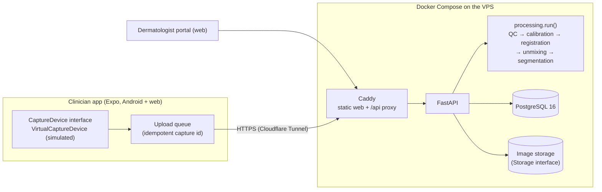

# SpektroSkin — GENOHACK 2026 prototype

> A second look shouldn't require a second hospital.

SpektroSkin is a research-stage concept for a smartphone-linked multispectral dermoscope for smaller
Indonesian hospitals (BPS class C/D). This repository is the **working end-to-end prototype built
during GENOHACK 2026** (24–25 Oct 2026). It validates the system architecture with the optical
hardware **simulated**:

simulated optical module → clinician app → backend (quality checks, calibration, spectral maps,
records) → dermatologist review portal → recommendation back to the clinician.

**Live demo:** https://spektroskin.zidan.dev (demo accounts on request) ·
**Build log:** [BUILD_LOG.md](BUILD_LOG.md) ·
**Evidence:** [docs/evidence/validation_report.md](docs/evidence/validation_report.md)

**What this is not:** no diagnosis, no cancer probability, no risk score. Automated outputs are
image quality checks, deterministic image processing, and one small learned image-quality
classifier trained on simulated captures only, shown as an advisory second opinion
([model card](docs/evidence/quality_model_card.md)). Every simulated element
carries a "Simulated" badge. No real or public patient images are used anywhere.

## Real vs simulated

| Part | Status in this prototype |
|---|---|
| Optical module (LEDs, sensor, spacer) | **Simulated**: `VirtualCaptureDevice` reads code-generated phantom frames |
| Skin images | **Simulated**: procedural phantoms with known melanin / hemoglobin ground truth |
| Quality checks (sharpness, glare, reference patches) | **Real code**, running on simulated frames |
| Calibration, registration, spectral unmixing, segmentation, area | **Real code**, running on simulated frames |
| Clinician app (Android via Expo Go, and web) | **Real** |
| Dermatologist review portal, case loop, polling | **Real** |
| Records, audit log, consent flag, demo auth | **Real** (demo auth only: no SSO or password reset) |
| Validation numbers | **Real computation on simulated data**: validates the processing math, not clinical performance |

## Built before vs during GENOHACK

| Before (not in this repo) | During GENOHACK (this repo, see BUILD_LOG.md) |
|---|---|
| Proposal, 12 customer-discovery interviews, Figma UI concept (layout ideas reused tonight as inspiration: analysis checklist, lesion timeline with a trend chart, greeting home with device card and stat tiles, filter pills; its risk scores and photo-like images were not used and the mockups are not in this repo), pitch deck drafts | Simulator + virtual device, processing pipeline with ground-truth tests, data model and API, clinician app, reviewer portal, deploy, validation report, offline queue, consent + audit, referral summary |

## Architecture



- **Device boundary:** the app only talks to `CaptureDevice` (`connect`, `status`, `capture`).
  A USB implementation replaces `VirtualCaptureDevice` with no other changes.
- **Processing boundary:** `processing.run(frame_set, device_profile)` is pure and deterministic.
  It runs on the server in this prototype; the target architecture moves it on-device.
- **Storage boundary:** the database stores object keys only; an S3-compatible adapter can replace
  `LocalStorage`.
- **Contract:** OpenAPI at `/api/docs`; TypeScript types are generated from it.

### Processing pipeline

1. **QC:** Laplacian-variance sharpness, saturated-pixel fraction (glare), gray reference patches.
   Failing captures get human-readable retake guidance.
2. **Calibration:** dark subtraction, flat-field correction (factory profile), per-capture LED gain
   drift corrected from the 18 % / 50 % gray patches on the spacer.
3. **Registration:** each band aligned to green by phase correlation (hand motion between flashes).
4. **Spectral maps:** per-pixel least-squares unmixing of −ln(R/R0) over 470 / 550 / 660 / 850 nm →
   melanin ("pigment view") and hemoglobin ("vascular view"); pseudo-RGB standard view.
5. **Segmentation:** Otsu threshold with hysteresis on the chromophore excess → outline and area
   (0.04 mm/px, fixed by the spacer).

The optical model is simplified and illustrative (Beer-Lambert-style, no scattering).

## Target architecture vs this prototype

The prototype deliberately simplifies the target design (described here as **target, not built**):

| Area | Target design | In this prototype |
|---|---|---|
| Optical module | LED ring (white cross-polarized + ~470/550/660/850 nm), cross-polarizers, ~10× macro lens, contact spacer with gray reference, MCU + constant-current driver; phone camera or external USB mono sensor without IR-cut filter. Phone NIR response is the first go/no-go | Simulated module with the same band set, spacer and reference patches |
| App | Offline-first; QC, calibration, maps and segmentation on-device; encrypted local storage wiped after sync | Processing on the server; offline upload queue on native |
| Backend | Identifiable clinical zone (Indonesia-hosted, FHIR-style records for later SATUSEHAT, consent registry, audit) and a de-identified research zone joined by consent-gated de-identification; designed for UU PDP 27/2022 | One zone; pseudonymous codes only; consent flag; audit log |
| AI | Staged: image quality → segmentation and change tracking → research-only triage support with abstention → RGB vs RGB+spectral ablation as the optics kill test | None by design. Classical QC and image processing only |
| Data | Public datasets for baselines → bench phantoms and volunteers → ethics-approved prospective collection at referral hospitals → review loop as a data flywheel | Synthetic phantoms only |

## Run locally

Prerequisites: Docker Desktop, [uv](https://docs.astral.sh/uv/), Node LTS.

```bash
cp .env.example .env                     # fill POSTGRES_PASSWORD and JWT_SECRET with random values
(cd backend && uv sync && uv run python -m simulator.generate --mobile ../mobile)
(cd mobile && npm ci && npx expo export -p web) && rm -rf web-dist && cp -R mobile/dist web-dist
docker compose up -d --build --wait      # http://localhost:8480 (API docs at /api/docs)
```

Create users (the password is read from stdin, never from arguments):

```bash
printf '%s\n' 'a-long-password' | docker compose exec -T api python -m scripts.create_user \
  --username clinician --role clinician --display-name "dr. Demo Clinician" --password-stdin
docker compose exec -T api python -m scripts.seed   # synthetic demo patients PT-0003/5/7
```

`scripts/provision.sh` does both from the macOS Keychain. Phone: `cd mobile && npx expo start`, then
open in Expo Go on the same Wi-Fi.

## Quality gate

`scripts/gate.sh` runs ruff, pytest (pipeline ground-truth recovery, QC rejection, schema and
scoping tests against a `*_test` database), TypeScript checks, the web export, the API smoke test
(`backend/scripts/smoke.py`) and Playwright end-to-end tests (390 px clinician flow; two-context
clinician → dermatologist → clinician loop). `scripts/deploy.sh` refuses to deploy unless on a
clean `main` with a green gate, ships the exact tested web export, and re-runs smoke and e2e
against the public URL.

## Repository map

| Path | What |
|---|---|
| `backend/app/processing/` | Pipeline: `optics`, `qc`, `calibration`, `registration`, `spectral`, `segmentation`, `render`, `validation` |
| `backend/simulator/` | Phantoms (ground truth) and the virtual device |
| `backend/app/api/` | FastAPI routers |
| `backend/alembic/` | Migrations (run on API start) |
| `mobile/src/app/` | Expo Router screens: `(clinician)`, `(reviewer)` |
| `mobile/src/device/` | `CaptureDevice` interface and `VirtualCaptureDevice` |
| `mobile/src/sync/` | Offline upload queue (native) |
| `docs/evidence/` | Validation report and figures |
| `PLAN.md`, `BUILD_LOG.md` | Decisions and the timestamped build record |
