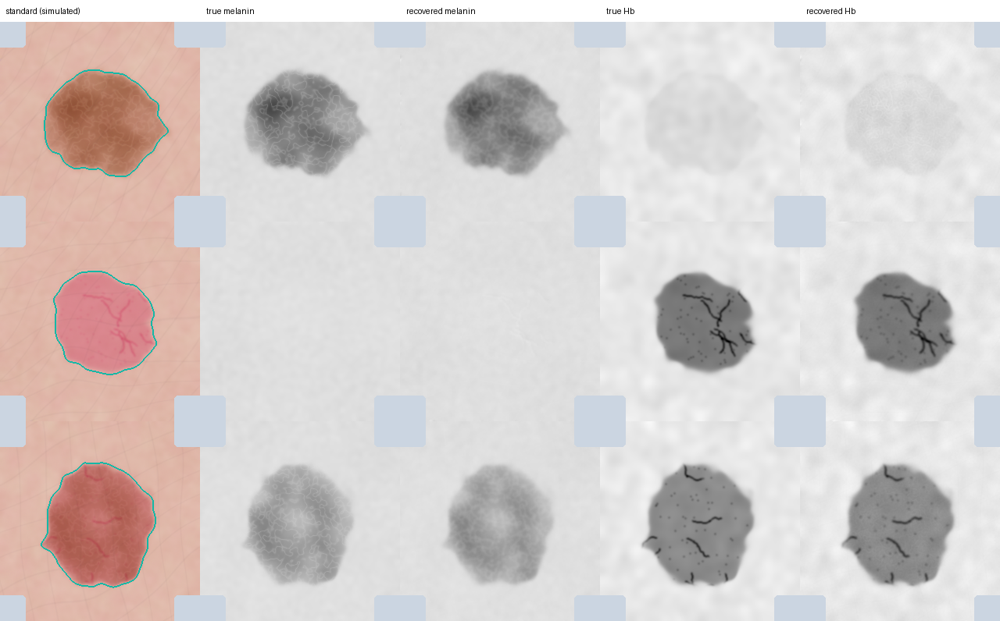
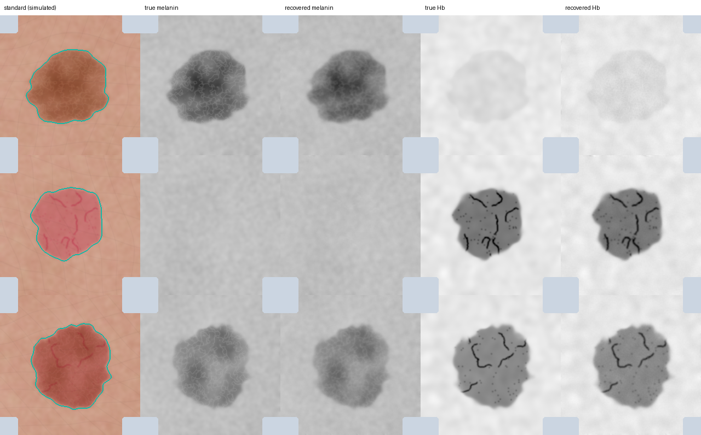
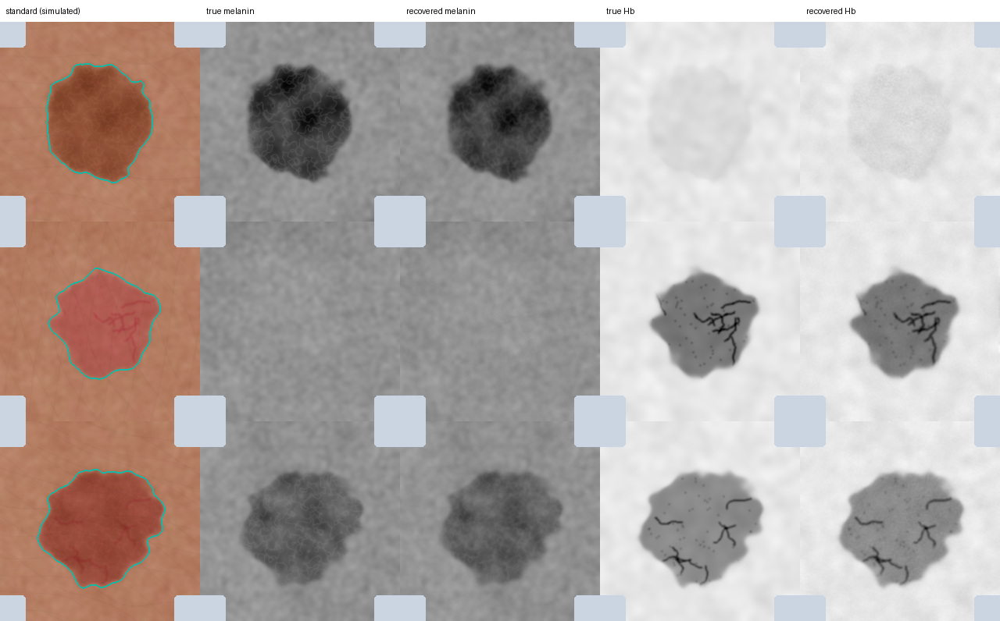

# Validation report: processing pipeline vs simulated ground truth

Generated 2026-10-24 15:01 UTC from commit `c55d991` with `uv run python -m scripts.validation_report --repeats 10` (deterministic seeds).

> **Scope.** This validates the *processing math* on *synthetic phantoms only*. The simulator and the pipeline share the same simplified optical model (Beer-Lambert-style, no scattering), so these numbers show that the pipeline inverts that model correctly under sensor noise, LED gain drift, vignetting and hand motion. They do **not** show that the model matches real skin, and they are **not** clinical performance. No real or public images were used. No diagnosis, risk score or AI is involved.

## Method

- Phantoms: pigmented, vascular and mixed lesions on three skin tones (light / medium / dark = Fitzpatrick III / IV / V, illustrative melanin levels).
- Each phantom captured 10 times with independent noise, per-band gain drift (±6 %) and per-band hand-motion shifts (±3 px).
- Pipeline: QC → dark/flat-field + reference-patch calibration → phase-correlation registration → least-squares unmixing of −ln(R/R0) → Otsu + hysteresis segmentation.
- Metrics (outside the spacer ring): Pearson r and RMSE of recovered vs true melanin and hemoglobin maps (model units), Dice of lesion mask vs true mask, signed area error.

## Results by skin tone

| Tone (Fitzpatrick) | Captures | QC pass (clean) | Melanin r | Hemoglobin r | Mask Dice | Area error, mean abs (max abs) |
|---|---|---|---|---|---|---|
| light (III) | 30 | 30/30 | 0.989 (worst 0.966) | 0.996 (worst 0.988) | 0.970 (worst 0.964) | 6.1 % (7.5 %) |
| medium (IV) | 30 | 30/30 | 0.995 (worst 0.983) | 0.995 (worst 0.985) | 0.975 (worst 0.967) | 5.0 % (6.8 %) |
| dark (V) | 30 | 30/30 | 0.987 (worst 0.864) | 0.991 (worst 0.971) | 0.969 (worst 0.962) | 6.4 % (7.8 %) |

Values are mean (worst) over captures. Worst = lowest r / Dice. Pearson r is low where a map has little true variation (melanin in vascular lesions); RMSE in the next table is the better measure there. Segmentation has a small positive area bias (it includes the soft lesion edge).

## Results by lesion type and tone

| Phantom | Melanin RMSE | Hemoglobin RMSE | Mask Dice | Area error mean (sd) |
|---|---|---|---|---|
| pigmented, light | 0.027 | 0.006 | 0.979 | +4.2 % (0.1) |
| vascular, light | 0.006 | 0.008 | 0.964 | +7.4 % (0.0) |
| mixed, light | 0.019 | 0.008 | 0.968 | +6.7 % (0.0) |
| pigmented, medium | 0.026 | 0.007 | 0.989 | +1.9 % (0.0) |
| vascular, medium | 0.008 | 0.010 | 0.967 | +6.8 % (0.0) |
| mixed, medium | 0.020 | 0.010 | 0.969 | +6.3 % (0.0) |
| pigmented, dark | 0.030 | 0.010 | 0.977 | +4.5 % (0.1) |
| vascular, dark | 0.019 | 0.012 | 0.963 | +7.7 % (0.1) |
| mixed, dark | 0.023 | 0.012 | 0.966 | +7.1 % (0.1) |

## Quality check: rejection of bad captures by tone

| Tone | Blur rejected | Glare rejected |
|---|---|---|
| light (III) | 10/10 | 10/10 |
| medium (IV) | 10/10 | 10/10 |
| dark (V) | 10/10 | 10/10 |

## Longitudinal series (acral sole, dark tone)

| Visit | True area | Measured area, mean (sd) |
|---|---|---|
| acral_dark_d01 | 18.0 mm² | 18.4 mm² (0.02) |
| acral_dark_d14 | 22.0 mm² | 22.6 mm² (0.02) |
| acral_dark_d30 | 28.0 mm² | 28.7 mm² (0.02) |

## Figures

*light tone (Fitzpatrick III): standard view, true vs recovered melanin, true vs recovered hemoglobin (darker = more). Synthetic phantoms.*

*medium tone (Fitzpatrick IV): standard view, true vs recovered melanin, true vs recovered hemoglobin (darker = more). Synthetic phantoms.*

*dark tone (Fitzpatrick V): standard view, true vs recovered melanin, true vs recovered hemoglobin (darker = more). Synthetic phantoms.*

## Limitations

- Same model generates and inverts the data (an "inverse crime"): real skin scattering, camera spectral response and LED spectra are not modelled.
- Skin-tone levels are illustrative and ordered, not fitted to measured Indonesian skin.
- Next step for real evidence: bench measurements on physical phantoms with known absorbers, then ethics-approved volunteer imaging (see the 12-month roadmap).
